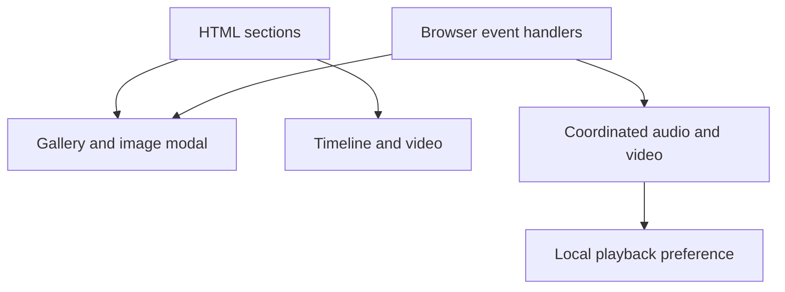

# Our Love Story

A personal memory site combining photographs, a relationship timeline, video, and music. I built it as a gift for my girlfriend.

**[Explore the live site](https://our-sweet-love-story.netlify.app/)**

## What it contains

- A gallery with a larger-image modal.
- Timeline sections and navigation between memories.
- Background music controls with remembered playback preference.
- Video visibility handling that coordinates playback with other media.

HTML · CSS · JavaScript. There is no application backend or npm build step.

## Source map

| File | Responsibility |
| --- | --- |
| [index.html](index.html) | Page sections, gallery, timeline, and media elements |
| [style.css](style.css) | Layout, responsive rules, and visual presentation |
| [script.js](script.js) | Modal behavior, audio fades/preferences, and visibility-driven media handling |



## Run locally

Serve the repository root with a static HTTP server; root-relative media paths assume root hosting. With Python installed:

```sh
python -m http.server 8080 --bind 127.0.0.1
```

Open `http://127.0.0.1:8080`. No package installation is needed. The embedded external video and local media have separate availability/codec dependencies.

## Review notes

Check section navigation, image-modal open/close behavior, sound controls, stored playback preference, and media entering/leaving the viewport. Browser autoplay policy can still require a user gesture. No automated regression suite or measured frame-rate/accessibility guarantee is asserted here.

The project intentionally keeps its personal story and visual character. No license file is currently included, so the previous MIT badge did not establish permission to reuse the code or media. Do not republish personal photographs, music, or third-party video merely because they are referenced by a public site.
